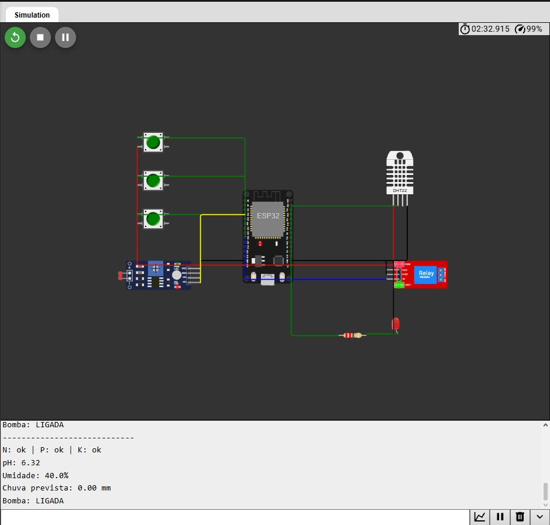

# FarmTech Solutions - Fase 2: Sistema de Irrigação Inteligente

**Curso:** Tecnologia em Inteligência Artificial.
**Grupo:** Samuel da Silva Meireles.

## 1. Introdução

Nesta fase do projeto da FarmTech Solutions desenvolvemos, em simulação, um sistema de irrigação automática para uma lavoura de **café**. A ideia foi montar um dispositivo com ESP32 que lê informações do solo e decide sozinho quando a bomba d'água deve ser ligada ou desligada.

Fizemos o circuito e a simulação no [Wokwi](https://wokwi.com) e programamos o ESP32 em C/C++. Como o Wokwi não possui sensores agrícolas, usamos as substituições propostas no enunciado, apresentadas a seguir.

## 2. Circuito

Usamos um ESP32 DevKit V1 e os componentes da tabela abaixo.

| Grandeza | Componente no Wokwi | Pino |
|---|---|---|
| Nitrogênio (N) | Botão verde | GPIO 12 |
| Fósforo (P) | Botão verde | GPIO 14 |
| Potássio (K) | Botão verde | GPIO 27 |
| pH do solo | LDR (módulo fotoresistor) | GPIO 34 |
| Umidade do solo | DHT22 | GPIO 15 |
| Bomba d'água | Relé azul | GPIO 26 |
| Alerta de pH | LED vermelho com resistor de 220 Ω | GPIO 2 |

Cada botão representa um nutriente: quando está pressionado, consideramos que o nutriente está presente no solo. O LDR representa o sensor de pH. A leitura analógica (0 a 4095) é convertida para a escala de 0 a 14, e alteramos o valor mudando a intensidade de luz do sensor. Para a umidade do solo usamos o DHT22, que na prática mede a umidade do ar, mas serve como substituto na simulação. O relé representa a bomba d'água, e o LED vermelho acende quando o pH está fora da faixa ideal.

Ligamos os botões ao 3V3 e configuramos os pinos com `INPUT_PULLDOWN`, de modo que a leitura é `LOW` com o botão solto e `HIGH` quando pressionado. O LDR e o DHT22 ficam no 3V3 e o relé no pino VIN.



A imagem mostra a simulação com os três nutrientes presentes, pH em 6,32 (dentro da faixa do café) e umidade em 40%. Nessa condição o relé fica ligado e o monitor serial mostra `Bomba: LIGADA`.

## 3. Cultura escolhida

Escolhemos o café e pesquisamos as condições ideais para ele. Adotamos pH do solo entre 6,0 e 6,5 e umidade entre 60% e 80%. Em relação aos nutrientes, o café exige bastante nitrogênio e potássio: o nitrogênio favorece o crescimento das folhas e o potássio se concentra nos frutos. O fósforo é necessário em menor quantidade, mas é importante para as raízes e tem baixo aproveitamento pelo solo. As doses e faixas exatas dependem da análise do solo e de orientação técnica. Nossas consultas foram em materiais da Embrapa Café ([Documentos 14](https://www.infoteca.cnptia.embrapa.br/infoteca/bitstream/doc/1136620/1/Embrapa-Cafe-Documentos-14-.pdf) e [este estudo](https://www.alice.cnptia.embrapa.br/alice/bitstream/doc/898221/1/19792.pdf)).

## 4. Lógica de decisão

A cada 2 segundos o ESP32 lê os sensores e decide o estado da bomba nesta ordem:

1. Se o pH está fora da faixa de 6,0 a 6,5, a bomba é desligada e o LED vermelho acende. Decidimos assim porque irrigar um solo com pH inadequado não corrige o problema e atrapalha a absorção dos nutrientes.
2. Se há previsão de chuva de 5 mm ou mais, a bomba fica desligada para economizar água.
3. Se menos de dois dos três nutrientes (N, P, K) estão presentes, a bomba também fica desligada e o monitor serial exibe um aviso.
4. Se nenhuma das condições anteriores se aplica, a umidade decide: abaixo de 60% a bomba liga, a partir de 80% ela desliga, e entre os dois valores o estado anterior é mantido. Essa faixa intermediária evita que o relé fique ligando e desligando perto do limite.

Em resumo, a bomba só liga quando o pH está adequado, não há chuva forte prevista, existem ao menos dois nutrientes e a umidade está abaixo de 60%. O código está em [`esp32/sketch.ino`](esp32/sketch.ino).

## 5. Testes realizados

Testamos a simulação variando o LDR, a umidade no DHT22 e os botões, e obtivemos os resultados abaixo.

| Situação | Resultado |
|---|---|
| pH dentro da faixa, 2 ou 3 nutrientes, umidade 40% | Bomba ligada |
| pH dentro da faixa, 2 ou 3 nutrientes, umidade 85% | Bomba desligada |
| pH fora da faixa | Bomba desligada e LED vermelho aceso |
| Menos de 2 nutrientes | Bomba desligada e aviso no monitor |
| Comando `CHUVA:12` no monitor serial | Bomba desligada, mesmo com umidade baixa |

Para simular, usamos o LDR em cerca de 145 lux (pH próximo de 6,1), alteramos a umidade clicando no DHT22 e associamos teclas do teclado aos botões (1, 2 e 3) para pressionar mais de um nutriente ao mesmo tempo.

## 6. Ir além

**Python e API pública.** Fizemos o script [`python/clima_ir_alem.py`](python/clima_ir_alem.py), que consulta a API gratuita Open-Meteo e obtém a previsão de chuva do dia para uma cidade. Como o Python não se comunica diretamente com o Wokwi rodando no navegador, o script exibe o comando `CHUVA:<mm>`, que digitamos no monitor serial da simulação. O ESP32 lê esse texto com `Serial.available()` e `Serial.read()` e usa o valor na decisão. Uso do script:

```bash
pip install requests pyserial
python clima_ir_alem.py "Caçapava, SP"
```

**Análise em R.** O script [`R/analise_irrigacao.R`](R/analise_irrigacao.R) lê o arquivo `R/leituras.csv`, com 20 leituras de umidade e pH, calcula média e desvio padrão e indica se a irrigação é recomendada, usando as mesmas faixas do código do ESP32. Os dados do arquivo são simulados e seguem o comportamento do nosso circuito. Para rodar, abrimos o script no RStudio com a pasta `R` como diretório de trabalho (também funciona com `Rscript analise_irrigacao.R`). Com esses dados, a média da umidade foi 59,48% e a do pH foi 6,20, e a recomendação foi irrigar, já que a umidade média ficou abaixo de 60%.

## 7. Vídeo

[Vídeo de demonstração no YouTube (não listado)](https://youtu.be/y90Pl3if51A?si=4H3C1GgDO-mPpP_i)

## 8. Estrutura do repositório

```
esp32/     sketch.ino, diagram.json, libraries.txt, circuito.jpg
python/    clima_ir_alem.py
R/         analise_irrigacao.R, leituras.csv
README.md
```

## 9. Conclusão

O trabalho nos permitiu praticar leitura de sensores, controle de um atuador, comunicação serial, consulta a uma API e análise de dados, tudo aplicado à agricultura. Como limitação, o pH e a umidade do solo são representados por componentes que apenas simulam essas grandezas, e a ligação entre o Python e o simulador é feita manualmente. Em um projeto real usaríamos sensores próprios de solo e a comunicação poderia ser automática por Wi-Fi.
